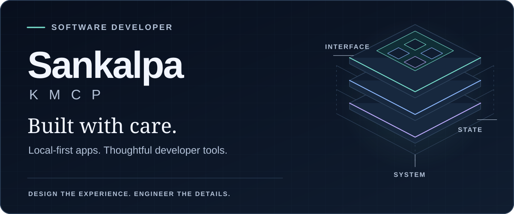
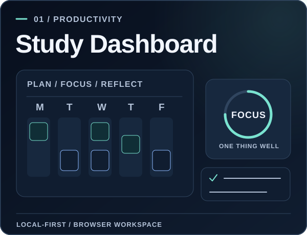
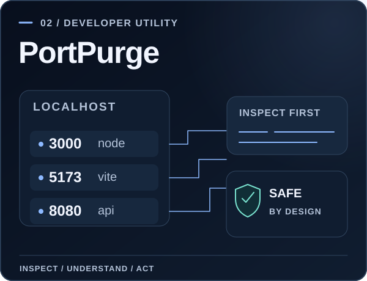
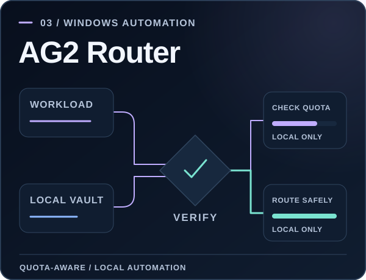
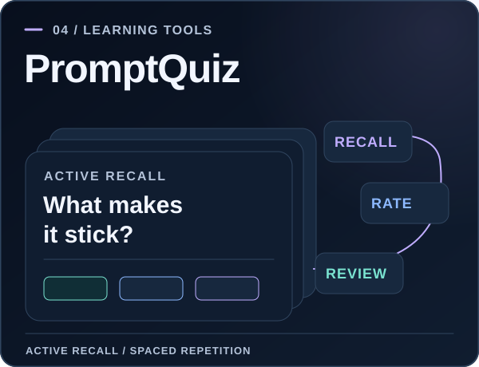

<!-- Profile README for github.com/Sankalpa-KMCP. Static visuals by design: no third-party counters or tracking. -->

  <picture>
    <source media="(prefers-color-scheme: dark)" srcset="./assets/banner-dark.svg" />
    <source media="(prefers-color-scheme: light)" srcset="./assets/banner-light.svg" />
    
  </picture>

   

  **Hi, I'm Sankalpa.** I build practical software for studying, developing, and getting things done.

  <a href="https://github.com/Sankalpa-KMCP?tab=repositories"><strong>Explore repositories</strong></a>
  &nbsp;·&nbsp;
  <a href="https://github.com/Sankalpa-KMCP/AG2-Router/releases"><strong>Downloads & releases</strong></a>
  &nbsp;·&nbsp;
  <a href="https://github.com/Sankalpa-KMCP/Sankalpa_KMCP"><strong>3D portfolio project</strong></a>

 

### Selected work

<table>
  <tr>
    <td width="50%" valign="top">
      
      
Offline-first study planning: subjects, tasks, notes, focus sessions, progress, and browser-based backups.

      
<a href="https://github.com/Sankalpa-KMCP/StudyApp"><strong>Source &amp; documentation →</strong></a>

    </td>
    <td width="50%" valign="top">
      
      
A cross-platform desktop utility for inspecting local ports and managing processes with safety controls.

      
<a href="https://github.com/Sankalpa-KMCP/PortPurge-System"><strong>Source &amp; documentation →</strong></a>

    </td>
  </tr>
  <tr>
    <td width="50%" valign="top">
      
      
A local Windows companion for managing model quotas, safe account switching, and private usage accounting.

      
<a href="https://github.com/Sankalpa-KMCP/AG2-Router"><strong>Source &amp; releases →</strong></a>

    </td>
    <td width="50%" valign="top">
      
      
Privacy-first quiz decks, active recall, SM-2 spaced repetition, and a copy-paste AI prompt builder.

      
<a href="https://github.com/Sankalpa-KMCP/promptQuiz"><strong>Source &amp; documentation →</strong></a>

    </td>
  </tr>
</table>

### What I like building

- **Local-first experiences** — useful tools that put people in control of their own data.
- **Practical developer utilities** — polished workflows that solve everyday engineering problems.
- **Reliable interfaces** — careful validation, accessible interactions, and maintainable code.

### Toolkit

`TypeScript` · `JavaScript` · `React` · `Vite` · `Tailwind CSS` · `Rust` · `Tauri` · `C# / .NET` · `Svelte` · `IndexedDB` · `Git` · `GitHub Actions`

### Also on my workbench

<a href="https://github.com/Sankalpa-KMCP/turbo_quiz">**TurboQuiz**</a> — browser-local quiz practice and review.  
<a href="https://github.com/Sankalpa-KMCP/Sankalpa_KMCP">**3D Portfolio**</a> — React Three Fiber scenes and animated transitions.  
<a href="https://github.com/Sankalpa-KMCP?tab=repositories">**More projects**</a> — browse the rest of my public work.

---

  Build with intention. Keep learning. Make it useful.

