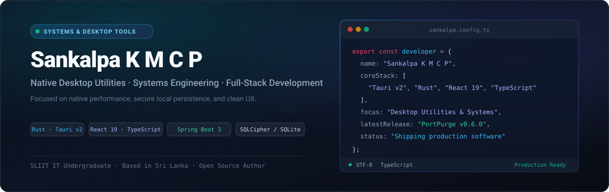

<picture>
  <source media="(prefers-color-scheme: dark)" srcset="./assets/banner-dark.svg" />
  <source media="(prefers-color-scheme: light)" srcset="./assets/banner-light.svg" />
  
</picture>

I'm an IT undergraduate at SLIIT. I build local-first web apps and desktop utilities, with a focus on keeping users in control of their data.

**[Try StudyApp](https://sankalpa-kmcp.github.io/StudyApp/)** · **[Download PortPurge](https://github.com/Sankalpa-KMCP/PortPurge-System/releases/latest)** · [LinkedIn](https://www.linkedin.com/in/sankalpa-k-m-c-p-2a900b3ba/)

## Featured projects

### StudyApp

A browser-based workspace for managing subjects, tasks, notes, and focus sessions. Study data stays in IndexedDB. When you restore a JSON backup, the app validates the file before replacing existing data.

React · TypeScript · Vite · Dexie

[Live demo](https://sankalpa-kmcp.github.io/StudyApp/) · [Repository and screenshots](https://github.com/Sankalpa-KMCP/StudyApp#screenshots)

### PortPurge

A cross-platform desktop utility for finding what’s listening on a local port. It shows the process behind the port before you act and includes controls for protected processes.

Rust · Tauri · React · TypeScript

[Download latest release](https://github.com/Sankalpa-KMCP/PortPurge-System/releases/latest) · [Repository](https://github.com/Sankalpa-KMCP/PortPurge-System)

### Olympia Fitness Center

A static site for a fitness center in Wadduwa, Sri Lanka, built with Astro and deployed to GitHub Pages. The project is set up for Vitest and Playwright.

Astro · TypeScript · Tailwind CSS

[Live site](https://sankalpa-kmcp.github.io/olympia-fitness-center/) · [Repository](https://github.com/Sankalpa-KMCP/olympia-fitness-center)

## Other projects

- [AG2 Router](https://github.com/Sankalpa-KMCP/AG2-Router) — A native Windows companion for Antigravity with account routing and a local usage dashboard. [Releases](https://github.com/Sankalpa-KMCP/AG2-Router/releases)
- [PromptQuiz](https://github.com/Sankalpa-KMCP/promptQuiz) — An offline study tool for active recall and spaced repetition, with quiz decks stored in the browser.

[Browse all repositories](https://github.com/Sankalpa-KMCP?tab=repositories)

<!-- Collaborative workspace metadata -->
